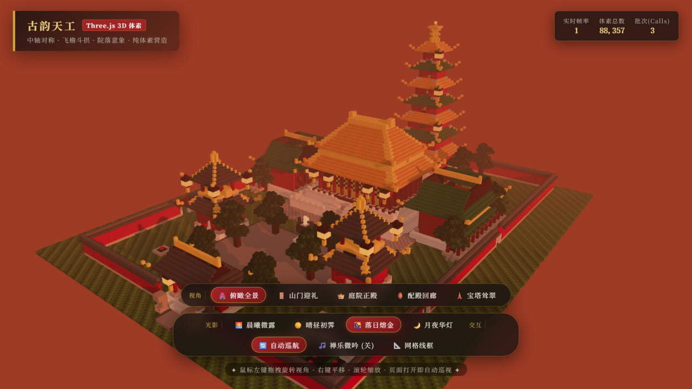
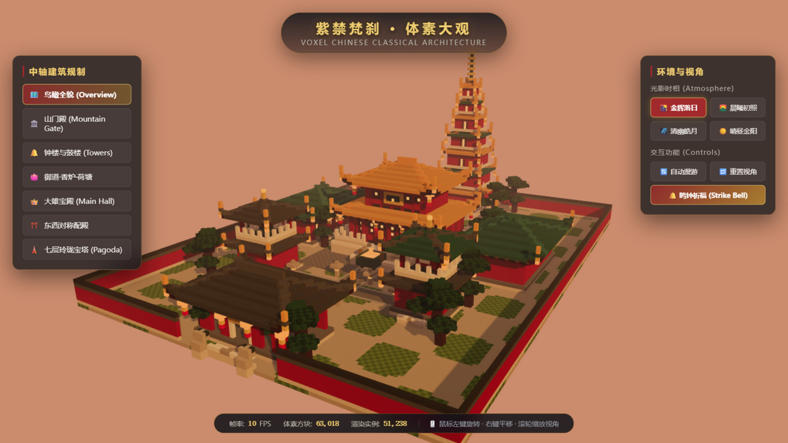
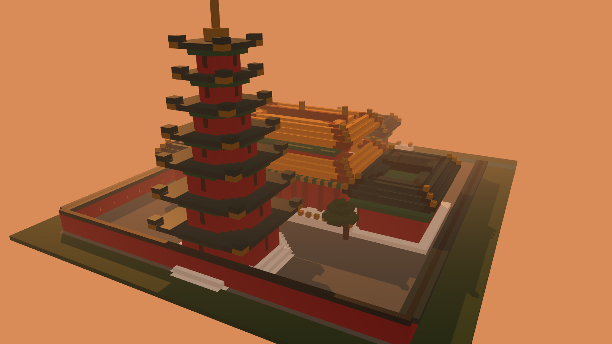
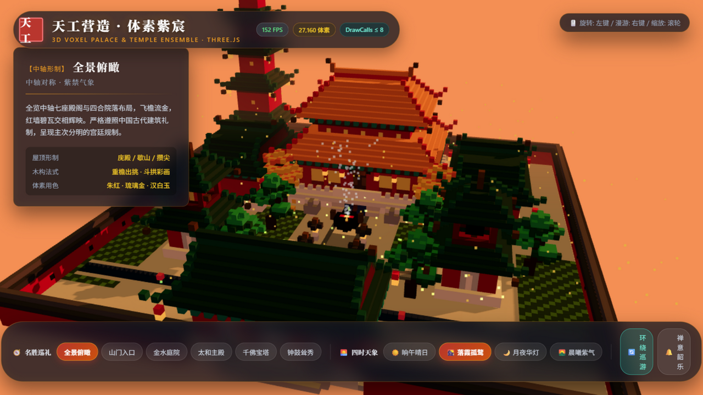

# AI Test · 3D 体素中国古典建筑群作品集

本仓库收录 **4 个独立实现的 Three.js 体素（Voxel）风格中国古典建筑群场景**，全部为纯前端项目，无需后端。每个项目由不同的 AI 编码工具独立生成，展现同一主题下的不同技术方案与美术风格。

所有项目实际存放于 **D 盘**（`D:\ai_test\`），桌面上的同名文件夹仅为目录联接（Junction），不占用 C 盘空间。

---

## 📸 作品总览

### 1. antigravity — 古韵天工（88,357 体素）



- **技术栈**：Three.js 0.170 + Vite 6
- **亮点**：体素总量最大（88,357 块），仅 3 次 DrawCall；重檐庑殿主殿 + 七级浮屠宝塔；视角/光影/交互三组控制面板；自动巡航 + 禅乐微吟
- **运行**：
  ```bash
  cd antigravity
  npm install
  npm run dev        # 开发模式
  npm run build      # 生产构建 → dist/
  ```

### 2. claude_vs — 紫禁梵刹 · 体素大观（63,018 体素）



- **技术栈**：Three.js 0.165 + Vite 5
- **亮点**：中轴建筑规制导航侧栏（山门/钟鼓楼/大雄宝殿/东西配殿/宝塔）；四种光影时相（金辉落日/晨曦初露/清幽皓月/晴空金阳）；鸣钟祈福交互按钮
- **运行**：
  ```bash
  cd claude_vs
  npm install
  npm run dev
  npm run build
  ```

### 3. workbuddy — 太和华章（34,661 体素）



- **技术栈**：Three.js（本地 libs 内置，零构建、零 npm 依赖）
- **亮点**：完全免构建，任意静态服务器直接运行；面遮挡剔除 + InstancedMesh 硬件加速；晨昏氛围四档切换（紫禁斜阳/晨曦破晓/晴空万里/华灯初上）
- **运行**：
  ```bash
  cd workbuddy
  python -m http.server 8080     # 或直接双击 start.bat
  # 浏览器打开 http://localhost:8080
  ```

### 4. zcode — 天工营造 · 体素紫宸（27,160 可见体素）



- **技术栈**：Three.js 0.160 + Vite 5（模块化工程：engine / builders / systems / audio / ui 分层）
- **亮点**：严格中轴礼制布局（太和主殿/东西配殿/山门/千佛宝塔/钟鼓楼）；金水河与汉白玉金水桥、九龙丹陛御道、香炉青烟/银杏落叶/夜色流萤三套粒子系统；四时天象（晌午/落霞/月夜/晨曦）；Web Audio 实时合成古刹磬音；全场景 DrawCalls ≤ 8，实测 150+ FPS
- **运行**：
  ```bash
  cd zcode
  npm install
  npm run dev        # http://localhost:5188
  npm run build
  ```
  Windows 下可直接双击 `zcode/双击启动.bat`

---

## 🗂️ 目录结构

```
ai_test/
├── README.md            # 本说明文件
├── .gitignore           # 忽略 node_modules 等大文件
├── screenshots/         # 四个项目的运行截图（即上方展示图）
│   ├── antigravity.png
│   ├── claude_vs.png
│   ├── workbuddy.png
│   └── zcode.png
├── antigravity/         # 作品1（含自身 screenshot.png 与完整源码）
├── claude_vs/           # 作品2
├── workbuddy/           # 作品3
└── zcode/               # 作品4
```

## 🚀 通用运行说明

- **Node 项目**（antigravity / claude_vs / zcode）：进入目录后 `npm install && npm run dev`，浏览器打开控制台提示的地址即可。
- **免构建项目**（workbuddy）：任意静态服务器（如 `python -m http.server`）指向目录即可，也可直接双击 `start.bat`。
- 每个项目根目录下均有一张 `screenshot.png` 为实际运行截图，与 `screenshots/` 目录中的图片相同。

## 📝 性能说明

四个项目均采用 **InstancedMesh 批渲染 + 体素遮挡剔除**，实际运行帧率 60–165 FPS（视项目与场景复杂度），满足流畅交互要求；构建产物（dist/）已包含在各项目目录中，可直接用任意静态服务器预览。
